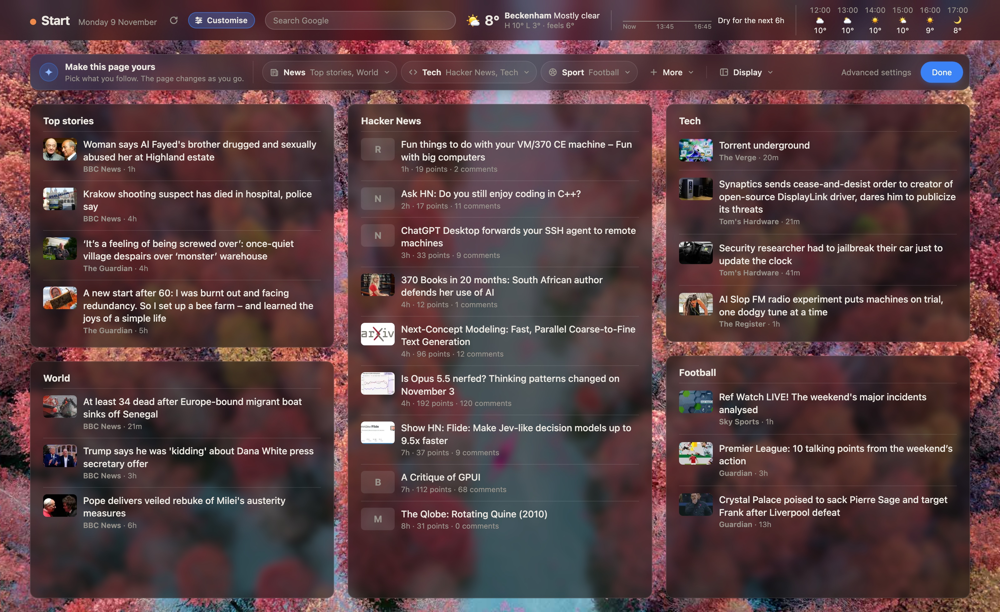
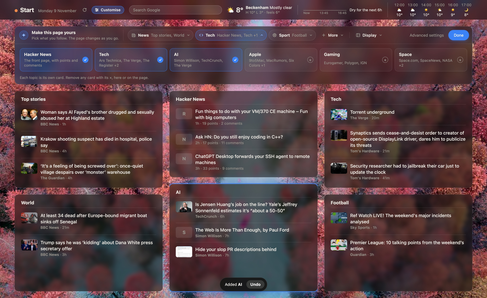
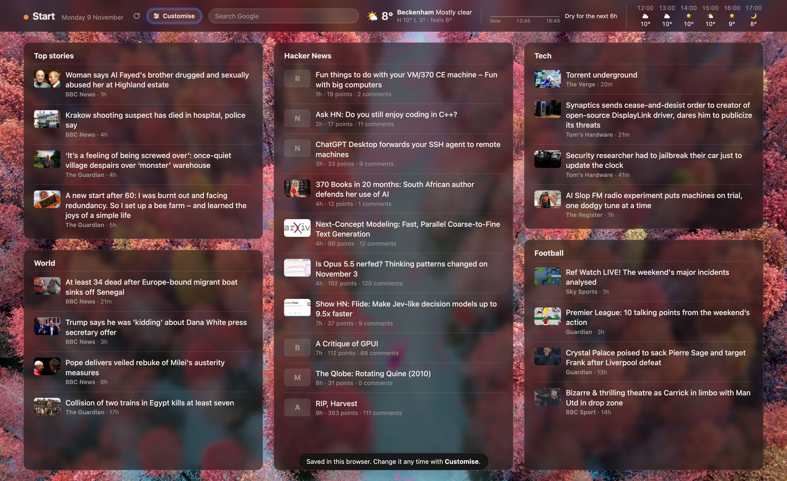
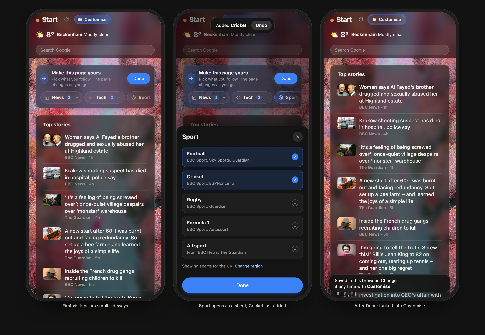

# Proposal: a setup bar instead of the setup screen

A new visitor lands on a page that is already full: Top stories, World, Hacker News, Tech and
Football. A compact **setup bar** sits between the masthead and the cards. Every choice in
it changes the cards underneath straight away, so there is no "Build my page" step and no
screen in the way of the content.

## Viewing the mockup

The prototype is live. It runs on the site's own `style.css`, `cards.js`, `stories.js`,
`layout.js`, `topics.js` and `forecast.js`, with a content snapshot from tab1.net
(`data/snapshot.json`, 9 Nov). Only the bar is new (`setup-bar.js`, `setup-bar.css`).

- Start the `mockups` server in `.claude/launch.json` (it serves the repo root on port 3061), then open
  <http://localhost:3061/mockups/setup-bar/> or `/mockups/setup-bar/phones.html`.
- The panel in the bottom-left corner jumps between states. Every state also has its own URL
  (`?open=sport&add=cricket`, `?state=returning`, `?region=us`). Add `review=0` to hide the panel.
- Screenshots of each state are in `screenshots/`.

## How it works

**1. Compact by default (one row, 56px).** The bar shows a short intro, then the three
pillars as pills, each listing what's on: `News · Top stories, World`, `Tech · Hacker News, Tech`,
`Sport · Football`. After them come the quieter `More` and `Display`, then `Advanced settings`
and `Done`. On narrower windows the summaries change to counts (`News 2`). Nothing is
modal and nothing is pre-opened.

**2. Expanding as needed.** Clicking a pillar opens its drawer under the bar (one at a time,
like tabs). Clicking it again or pressing Escape closes it. The cards shrink to make room, so
you can still see them while you choose.

| Drawer | Contents |
|---|---|
| **News** | Topic chips (Top stories, World, Politics, Business, Science & environment, Health, Culture), source chips (paywall tags kept), region (UK / US / Both), "one card per topic / per source" |
| **Tech** | Tiles: Hacker News, Tech, AI, Apple, Gaming, Space. Each shows where its stories come from |
| **Sport** | Tiles: Football, Cricket, Rugby, Formula 1, All sport (NFL, NBA and MLB for the US) |
| **More** | Film & TV, Food, Travel, Personal finance, and a link to add any RSS feed (Advanced) |
| **Display** | Pictures or headlines only, density, weather, daily photo |

News uses chips because a topic is a mix of outlets. Tech and Sport use tiles because each
topic has its own fixed sources, so the tile can say what you'll get.

**3. The page answers at once.** Turning a topic on adds its card at the end of the layout
(the same rule `layoutForProfile` uses today). The new card glows briefly and scrolls into
view, and a toast says `Added AI · Undo`. Turning a topic off removes its card. A card's own ×
does the same thing, and the bar updates to match.

**4. Done.** The bar tucks away and the masthead's **Customise** button pulses once, with
"Saved in this browser. Change it any time with Customise." Returning visitors only see the
Customise button. It reopens the same bar, titled "Customise your page", with changes saved
as you go.

**5. Settings becomes "Advanced settings".** Customise (a labelled pill rather than the
sliders icon) is now the way in. The current Settings screen keeps card order, stories per
card, fill/auto-arrange, temperature unit, your own feeds, import/export, history and start
over. The bar links to it in two places: its right-hand end and the Display drawer.

**6. Phones.** The pillars scroll sideways under the intro. A drawer opens as a bottom
sheet with full-width tiles and a large Done button. Phones show one column, so the toast
says what changed.

## Why this shape

- **Content first:** a visitor's first view is a working page, not a form. The current
  modal shows 30+ chips before any content.
- **The page is the preview:** choices act on the real cards, so people see what they get
  and can't make a page they didn't expect.
- **Small to start, more when asked:** three pillars on show, details in drawers, and the
  power features one level further in, in Advanced settings.
- **Easy to leave:** Done, Escape and Undo are always there. If someone ignores the bar, the
  defaults are still a good page.

## What carries over from today's code

- `profile` (outlets, topics, style, pictures, weather, backdrop) and `catalogue.json` are
  unchanged. The pillars are just a grouping of catalogue topic ids, so they could live in
  the catalogue as `"pillar": "news" | "tech" | "sport" | "more"`.
- Each toggle calls `setProfile` (or a lighter `updateProfile`) straight away instead of
  waiting for a submit. History/undo already records each change, so the toast's Undo can
  be `undo()`.
- `onboarded` is set on Done (as Skip does today). `setup.js`'s dialog and its
  `/settings/topics-and-sources` route are replaced by the bar; that URL could open the bar instead.

## Things to decide before building

1. **Default page for everyone.** The new defaults (Top stories, World, HN, Tech, Football)
   should also be what the server renders for no-JS and first paint. Today `feeds.json`'s home
   tab is BBC News, BBC Football, HN, AI, Tech, Science and Space, so a new visitor would see
   the page change as the bar's defaults load. Suggest moving the default page onto the
   catalogue (open question 3 in ONBOARDING-PLAN.md) as part of this work.
2. **How long the bar stays.** As mocked, it stays (compact) until Done. Alternative: it
   tucks itself away after, say, three visits, or after the first change plus one more visit.
3. **Where region lives.** It's in the News drawer, with a "Change region" link from Sport.
   The time-zone guess means most people never need it. A small `UK ▾` on the bar is the
   alternative.
4. **More.** Keep it as a fourth, quieter pillar (as mocked), or fold Film & TV into News and
   drop Food, Travel and Personal finance from first-run choices.
5. **Display in the bar or only in Advanced?** It's in the bar because pictures and density
   are visible choices that change the look of the page, but it could move to Advanced.
